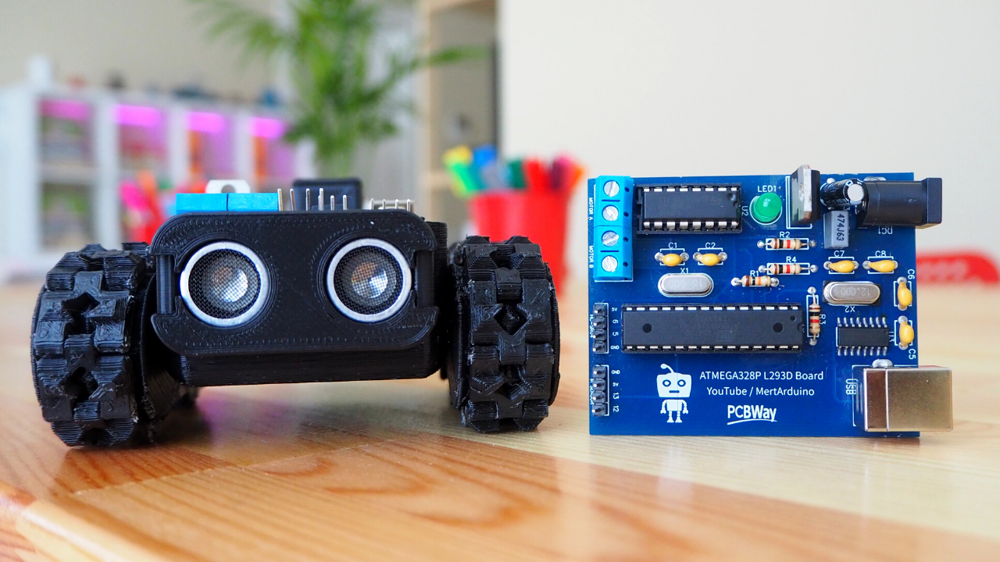
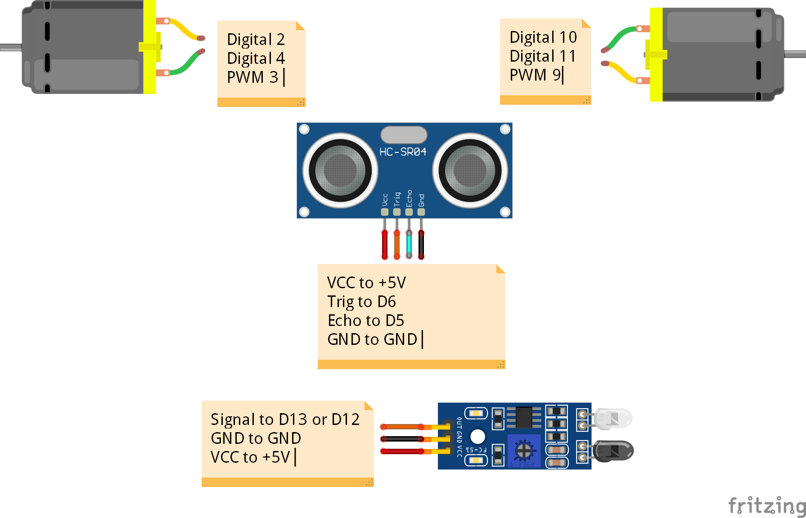
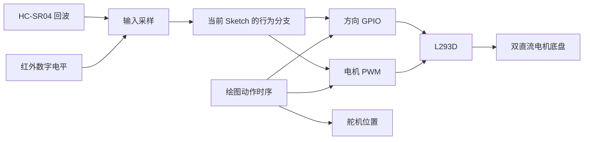

# 多模式移动机器人控制板

**传感器感知 · 双电机 PWM 控制 · 五种运动行为 · 舵机轨迹绘制**

围绕 ATmega328P 控制板与双直流电机底盘，使用超声波、红外传感器和舵机组织不同的机器人运动行为。项目把距离检测、数字量输入、电机方向控制、PWM 输出和动作时序串成可阅读、可编译的独立工程，适合从执行器控制逐步理解移动机器人的感知与决策链路。



## 项目内容

| 模式 | 感知与输入 | 运动行为 | 源码入口 |
| --- | --- | --- | --- |
| 红外循迹 | 单路红外数字输入 | 根据红外电平切换两组电机方向组合 | [Line_Follower_Mode](firmware/Line_Follower_Mode/Line_Follower_Mode.ino) |
| 超声避障 | HC-SR04 回波脉宽 | 距离小于 10 cm 时停车、单侧转向；其余分支前进 | [Obstacle_Avoiding_Mode](firmware/Obstacle_Avoiding_Mode/Obstacle_Avoiding_Mode.ino) |
| 距离跟随 | HC-SR04 测距 | 按近距离、中间距离和搜索距离执行后退、停车、前进及单侧电机动作 | [Follow_Me_Mode](firmware/Follow_Me_Mode/Follow_Me_Mode.ino) |
| 边界响应 / Sumo | 红外边界检测 | 在触发分支中执行停车、后退和转向动作序列 | [Sumo_Mode](firmware/Sumo_Mode/Sumo_Mode.ino) |
| 舵机绘图 | 预设动作时序 | 70° / 120° 舵机位置与底盘直行、转向组合，绘制运动轨迹 | [Drawing_Mode](firmware/Drawing_Mode/Drawing_Mode.ino) |

五个模式分别编译、分别烧录，每个目录都是一个独立 Arduino Sketch。模式按实验场景选择，控制板通过相同的电机接口复用底盘。

## 硬件组成

- **主控：** ATmega328P，Arduino Uno 兼容开发方式。
- **电机驱动：** L293D 双通道电机驱动，分别控制左右直流减速电机。
- **距离感知：** HC-SR04 超声波模块，使用触发信号和回波脉宽计算距离。
- **地面感知：** 数字输出红外传感器，为循迹与边界响应提供输入。
- **轨迹绘制：** 舵机调整笔的工作位置，配合底盘动作留下轨迹。
- **下载接口：** CH340G USB 转串口，配合带引导程序的主控烧录。



具体引脚、各模式接线和舵机使用的定时器说明见 [硬件与接口](docs/HARDWARE.md)。

## 控制链路



控制重点分为三层：读取传感器、判断当前行为、输出执行器信号。超声模式使用 `pulseIn()` 测量回波，红外模式读取数字电平，绘图模式使用顺序动作配合舵机。电机方向由四个 GPIO 控制，两个使能引脚通过 `analogWrite()` 设置 PWM 占空比。

各分支阈值、动作持续时间和参数位置见 [模式与控制逻辑](docs/CONTROL.md)。

## 源码目录

```text
.
├── firmware/
│   ├── Line_Follower_Mode/       红外循迹 Sketch
│   ├── Obstacle_Avoiding_Mode/   超声避障 Sketch
│   ├── Follow_Me_Mode/           距离跟随 Sketch
│   ├── Sumo_Mode/                边界响应 Sketch
│   └── Drawing_Mode/             舵机绘图 Sketch
├── docs/
│   ├── HARDWARE.md               器件组成、引脚和接线
│   ├── CONTROL.md                模式分支、参数与动作时序
│   ├── BUILD.md                  编译、烧录和检查方法
│   └── SOURCE.md                 来源、文件映射和许可证
├── third_party/RobotControlBoard/ 原项目说明与实物、接线图片
├── source-manifest.json          原始文件路径及 SHA-256 对照
├── .github/workflows/compile.yml  五个 Sketch 的独立编译检查
└── LICENSE                       GPL-3.0 许可证
```

阅读时可以先看 [超声避障](firmware/Obstacle_Avoiding_Mode/Obstacle_Avoiding_Mode.ino)，了解输入、判断和电机输出如何连接，再对照 [距离跟随](firmware/Follow_Me_Mode/Follow_Me_Mode.ino) 比较距离分段策略，最后阅读 [绘图模式](firmware/Drawing_Mode/Drawing_Mode.ino) 的舵机与底盘动作配合。

## 编译与使用

Arduino IDE 中选择 **Arduino Uno**，打开一个模式目录里的同名 `.ino` 文件。绘图模式使用 Arduino Servo 库。选择对应串口后执行验证与上传。

也可以使用 Arduino CLI：

```sh
arduino-cli core update-index
arduino-cli core install arduino:avr@1.8.6
arduino-cli lib install Servo@1.2.2
arduino-cli compile --fqbn arduino:avr:uno firmware/Obstacle_Avoiding_Mode
arduino-cli upload --fqbn arduino:avr:uno --port COM5 firmware/Obstacle_Avoiding_Mode
```

完整命令和五模式检查步骤见 [编译与运行](docs/BUILD.md)。

## 工程关注点

1. **感知与动作的映射：** 从红外电平和距离区间出发，逐项对应电机方向与占空比，便于核对行为是否符合接线。
2. **左右电机的一致性：** 各模式分别设置左右 PWM 参数，结合电机安装方向理解不同输出组合对应的底盘动作。
3. **动作时序的组织：** 避障与边界响应把停车、转向等动作按时间串联；绘图进一步将舵机位置纳入动作序列。
4. **外设资源分配：** 超声回波与绘图舵机按模式使用 D5；绘图时通过 D3、D9 驱动电机，并使用 Servo 库输出舵机信号。
5. **工程复现：** 统一 Sketch 目录结构，记录原始文件校验值，并在 GitHub Actions 中分别编译五个模式。

## 来源与许可证

本项目基于 [maker101io / RobotControlBoard](https://github.com/maker101io/RobotControlBoard) 整理，保留原始示例、图片、说明和 GPL-3.0 许可证。仓库增加中文工程文档、Arduino Sketch 目录组织、来源校验清单和自动编译配置。文件对应关系见 [来源说明](docs/SOURCE.md)。
